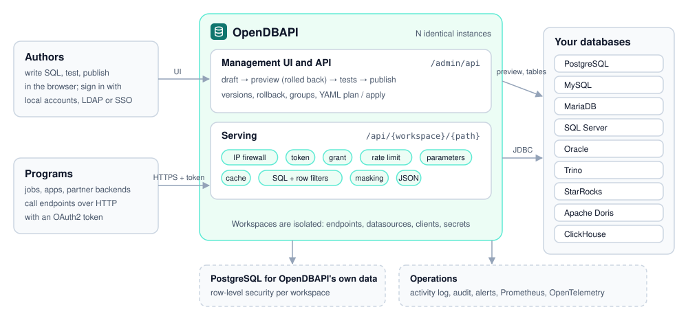
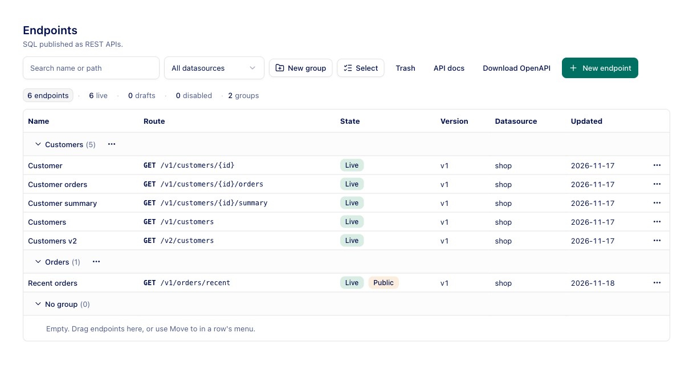
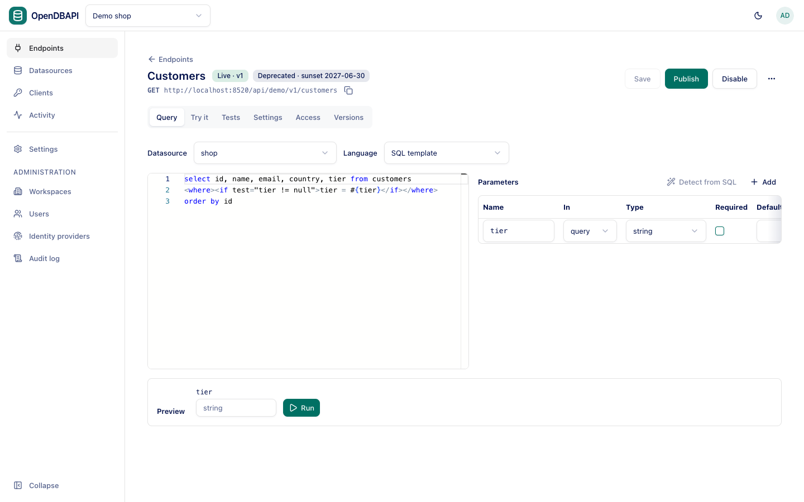

<div align="center">

<picture>
  <source media="(prefers-color-scheme: dark)" srcset=".github/assets/opendbapi-wordmark-dark.svg">
  
</picture>

### Publish SQL as REST APIs

Write a query, declare its parameters and publish it. Programs call it over HTTP with an OAuth2 token and get JSON
back,\
without a service to write or database credentials to hand out.

[](https://github.com/egret-data/opendbapi/actions/workflows/ci.yml)
[](https://egret-data.github.io/opendbapi/)
[](https://github.com/egret-data/opendbapi/releases)
[](LICENSE)
[](backend/pom.xml)

[**Documentation**](https://egret-data.github.io/opendbapi/) ·
[**Quick start**](#quick-start) ·
[**Architecture**](#how-it-fits-together) ·
[**Known issues**](https://egret-data.github.io/opendbapi/reference/known-issues) ·
[**Contributing**](CONTRIBUTING.md)

<br>

<picture>
  <source media="(prefers-color-scheme: dark)" srcset=".github/assets/architecture-dark.svg">
  
</picture>

</div>

## What is OpenDBAPI

OpenDBAPI turns SQL into versioned, access-controlled REST endpoints. An author writes a query against one of your
databases, tries it, and publishes it; the endpoint is then served at `/api/{workspace}/{path}`. Any program with a
token, such as a nightly job, a partner's backend or a mobile app, can call it.

Use it when something that is not a person needs the answer to a query you control:

- **No service per query.** Endpoints are configuration: a SQL template, typed parameters, and settings for paging,
  caching and the shape of the result. Publishing one takes seconds and needs no deployment.
- **No shared database passwords.** Callers get OAuth2 client credentials and grants per endpoint or per group.
  Data policies mask columns and filter rows by who is calling.
- **Changes you can review.** Every endpoint has a draft and numbered versions with rollback, saved tests that can
  gate publishing, and a YAML export you can keep in Git and `plan` / `apply` like Terraform.

OpenDBAPI is a clean-room rewrite of the ideas behind DBAPI and imports DBAPI exports.
It is a Java 21 / Spring Boot application with a React UI, shipped as one container image that keeps its own data in
PostgreSQL.

## Highlights

| Area | What you get | |
|---|---|---|
| **Endpoints** | SQL templates with `<if>` / `<where>` / `<foreach>`, typed parameters and rules, offset and keyset paging, result mapping, caching, NDJSON and CSV streaming. Groovy scripts and multi-step workflows when SQL alone is not enough. | [Docs](https://egret-data.github.io/opendbapi/endpoints/write-and-publish) |
| **Publishing** | Drafts, preview (always rolled back), publish, versions and rollback, test cases that must pass, side-by-side major versions with deprecation and sunset headers, folder-style groups. | [Docs](https://egret-data.github.io/opendbapi/endpoints/versions-and-majors) |
| **Access** | Service accounts with OAuth2 client credentials, grants per endpoint or group, IP firewall and rate limits per workspace, HMAC-signed requests and encrypted responses. | [Docs](https://egret-data.github.io/opendbapi/access/clients) |
| **Data policies** | Column masks and row filters chosen by the caller's attributes, applied to every call, including streamed results. | [Docs](https://egret-data.github.io/opendbapi/access/data-policies) |
| **Operations** | An activity log of every call, slowest endpoints and clients, webhook alerts (Slack, Teams, Google Chat), an audit log, Prometheus metrics and OpenTelemetry tracing. | [Docs](https://egret-data.github.io/opendbapi/workspace/activity-and-audit) |
| **Configuration as code** | Export a workspace as YAML, then `opendbapi plan` and `apply` it from CI; import DBAPI exports as drafts. | [Docs](https://egret-data.github.io/opendbapi/config/plan-and-apply) |
| **People and deployment** | Workspaces, roles, sign-in with local accounts, LDAP or SSO (OIDC) with group mapping; secrets from OpenDBAPI or HashiCorp Vault; Docker and a Helm chart; UI in English and Vietnamese. | [Docs](https://egret-data.github.io/opendbapi/deploy/authentication) |

Datasources: PostgreSQL, MySQL, MariaDB, SQL Server, Oracle, Trino, StarRocks, Apache Doris and ClickHouse, and
[HTTP APIs](https://egret-data.github.io/opendbapi/datasources/http-apis): put an existing REST API behind the same access
control, masking, caching and activity log.

## Screenshots

<table>
  <tr>
    <td width="50%"><br><sub>Endpoints in a workspace, organized in groups. A grant on a group covers every endpoint in it.</sub></td>
    <td width="50%"><br><sub>An endpoint's query: a SQL template, its parameters, and a preview that is always rolled back.</sub></td>
  </tr>
</table>

## Quick start

Run OpenDBAPI and a small sample shop database with Docker Compose:

```bash
git clone https://github.com/egret-data/opendbapi.git
cd opendbapi
docker compose -f deploy/quickstart/docker-compose.yml up -d
docker compose -f deploy/quickstart/docker-compose.yml exec -T postgres \
  psql -U postgres -d opendbapi < deploy/quickstart/sample-data.sql
```

Then open <http://localhost:8520> and sign in as `admin` / `admin-change-me`.

- **Needs** Docker with Compose v2. The stack pulls `ghcr.io/egret-data/opendbapi:0.3.1` and PostgreSQL 16.
- **Next:** [publish your first endpoint](https://egret-data.github.io/opendbapi/get-started/first-endpoint) on the sample
  shop.
- **Demo only.** The quick start uses fixed, published passwords and master key. To run OpenDBAPI for real, follow
  [Deploy with Docker](https://egret-data.github.io/opendbapi/deploy/docker) or
  [on Kubernetes](https://egret-data.github.io/opendbapi/deploy/kubernetes).

## How it fits together

- **One application.** A Spring Boot app serves the management UI and API (`/admin/api`) and the published endpoints
  (`/api/{workspace}/{path}`). Every instance is identical; scale by adding instances, with no sticky sessions or Redis.
- **State in PostgreSQL.** OpenDBAPI keeps users, workspaces, endpoints, versions and the activity log in one
  PostgreSQL 14+ database, with row-level security per workspace. Sessions, request nonces and cache invalidation
  (`LISTEN/NOTIFY`) go through it too.
- **Serving pipeline.** Each call passes the IP firewall, token and grant checks, and rate limits; then its parameters
  are bound and validated, the SQL is rendered with row filters and run with a timeout, and the result is masked,
  mapped and returned as JSON. Try-it in the UI goes through this same pipeline.
- **Identity.** People sign in with local accounts, LDAP or OIDC, and identity-provider groups map to workspace roles.
  Programs use OAuth2 client credentials (`POST /oauth2/token`).
- **Secrets.** Datasource passwords and webhook URLs are sealed with a master key, or read from environment variables
  or HashiCorp Vault.

The design, including every rule above, is in [`docs/SPEC.md`](docs/SPEC.md) (Vietnamese).

## Documentation

| | |
|---|---|
| [Get started](https://egret-data.github.io/opendbapi/get-started/quick-start) | Quick start, concepts, your first endpoint. |
| [Endpoints](https://egret-data.github.io/opendbapi/endpoints/write-and-publish) | Write, test, publish and version endpoints; groups, scripts and workflows. |
| [Access](https://egret-data.github.io/opendbapi/access/clients) | Service accounts, grants, calling endpoints, data policies, request signing. |
| [Workspace](https://egret-data.github.io/opendbapi/workspace/members-and-roles) | Members and roles, security, secrets, alerts, activity and audit. |
| [Configuration as code](https://egret-data.github.io/opendbapi/config/yaml-format) | The YAML format, `plan` / `apply`, CI, importing from DBAPI. |
| [Deploy](https://egret-data.github.io/opendbapi/deploy/docker) | Docker, Kubernetes, sign-in providers, Vault, operations. |
| [Reference](https://egret-data.github.io/opendbapi/reference/configuration) | Configuration, errors, the Management API. |
| [Known issues](https://egret-data.github.io/opendbapi/reference/known-issues) | Problems in the current release and how to work around them. |

The site's source is in [`docs/`](docs/); a change that alters what users see ships with its docs update.

## Repository layout

```text
backend/            Maven multi-module, Java 21, Spring Boot 3.3
  opendbapi-sql/      SQL templates, expression language, static checks, paging (plain Java)
  opendbapi-core/     schema (Flyway), workspace isolation, configuration
  opendbapi-admin/    management API under /admin/api
  opendbapi-serving/  published endpoints under /api/{workspace}/**
  opendbapi-cli/      `opendbapi export | plan | apply` command line
  opendbapi-app/      the Spring Boot application (bundles the UI)
frontend/           React 19, Vite, Tailwind v4
deploy/             quickstart and dev Compose stacks, Helm chart
docs/               documentation site (Docusaurus), SPEC.md and STYLE.md
openapi.json        management API contract; the frontend client is generated from it
Dockerfile          one image: API and UI
```

## Status

The current release is [0.3.1](https://github.com/egret-data/opendbapi/releases/tag/v0.3.1). Everything in the
highlights above is built and tested. Elasticsearch datasources are deferred until there is a need.
Problems in the current release are listed in
[Known issues](https://egret-data.github.io/opendbapi/reference/known-issues).

## Contributing and security

Read [CONTRIBUTING.md](CONTRIBUTING.md) to run OpenDBAPI from source and for the checks a pull request must pass:
Conventional Commits, tests with every change, and docs with every user-visible change. Report a vulnerability as
[SECURITY.md](SECURITY.md) describes, not in a public issue.

## License

Licensed under the [Apache License 2.0](LICENSE). The UI frame and shared components under `frontend/` derive from
[Egret](https://github.com/egret-data/platform) (Apache-2.0); see [`NOTICE`](NOTICE).
