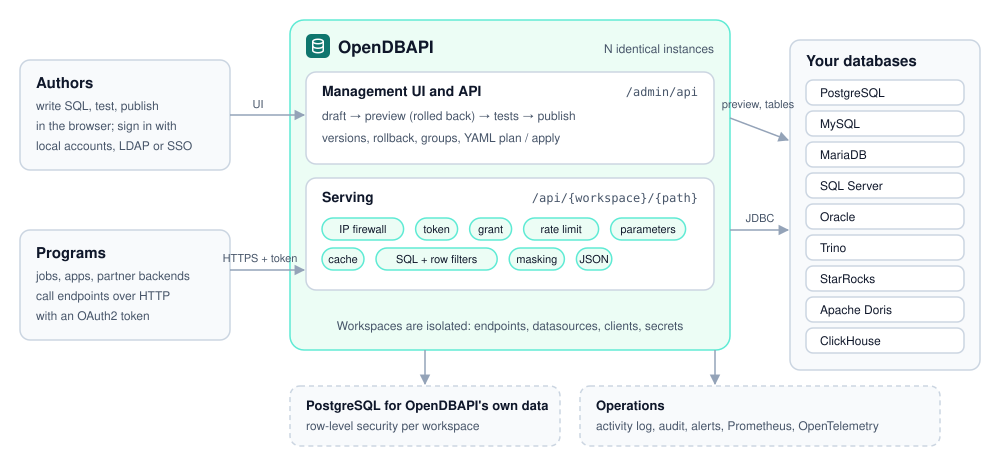
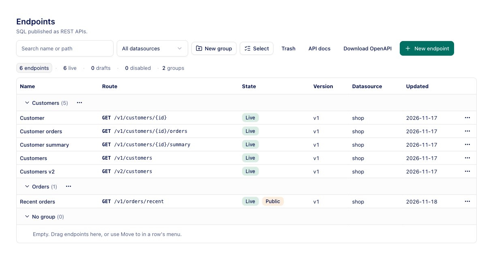
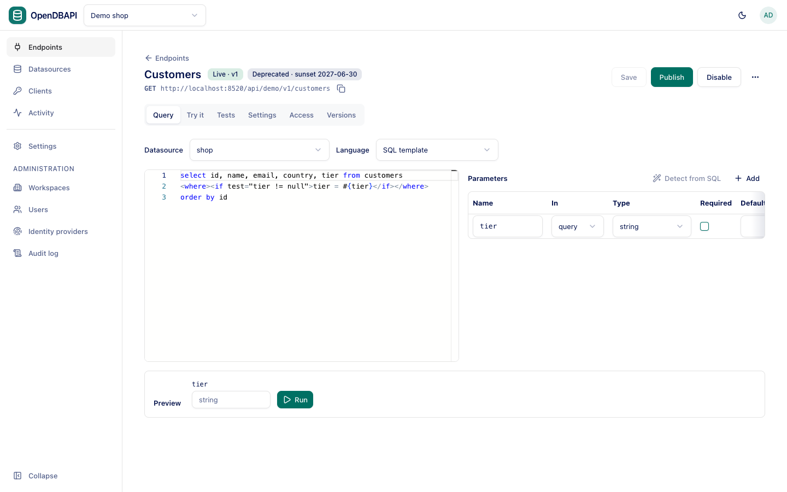

<div align="center">

<picture>
  <source media="(prefers-color-scheme: dark)" srcset=".github/assets/opendbapi-wordmark-dark.svg">
  
</picture>

### Biến câu SQL thành REST API

Viết một câu truy vấn, khai báo tham số rồi publish. Chương trình gọi nó qua HTTP bằng OAuth2 token và nhận về JSON,\
không phải viết service, không phải đưa mật khẩu database cho ai.

[](https://github.com/egret-data/opendbapi/actions/workflows/ci.yml)
[](https://egret-data.github.io/opendbapi/)
[](https://github.com/egret-data/opendbapi/releases)
[](LICENSE)
[](backend/pom.xml)

[**Tài liệu**](https://egret-data.github.io/opendbapi/) ·
[**Chạy thử nhanh**](#chạy-thử-nhanh) ·
[**Kiến trúc**](#các-phần-khớp-với-nhau-thế-nào) ·
[**Vấn đề đã biết**](https://egret-data.github.io/opendbapi/reference/known-issues) ·
[**Đóng góp**](CONTRIBUTING.md)

<sub>⚠️ Bản tham khảo tiếng Việt. Bản gốc (canonical) là tiếng Anh: [`README.md`](README.md).</sub>

<br>

<picture>
  <source media="(prefers-color-scheme: dark)" srcset=".github/assets/architecture-dark.svg">
  
</picture>

</div>

## OpenDBAPI là gì

OpenDBAPI biến câu SQL thành REST endpoint có phiên bản và có kiểm soát truy cập. Author viết câu truy vấn trên một
database của bạn, chạy thử rồi publish; endpoint được phục vụ tại `/api/{workspace}/{path}`. Bất kỳ chương trình nào có
token, như job chạy đêm, backend của đối tác hay ứng dụng di động, đều gọi được.

Dùng nó khi một thứ không phải con người cần kết quả của một câu truy vấn do bạn kiểm soát:

- **Không cần một service cho mỗi câu truy vấn.** Endpoint là cấu hình: một SQL template, tham số có kiểu, và các thiết
  lập phân trang, cache, hình dạng kết quả. Publish mất vài giây và không cần deploy.
- **Không chia sẻ mật khẩu database.** Bên gọi nhận OAuth2 client credentials và được cấp quyền theo từng endpoint hoặc
  theo group. Data policy che cột và lọc dòng theo người gọi.
- **Thay đổi xem lại được.** Mỗi endpoint có bản nháp và các phiên bản đánh số có thể rollback, test case lưu sẵn có thể
  chặn publish, và bản export YAML để giữ trong Git và `plan` / `apply` như Terraform.

OpenDBAPI viết lại từ đầu (clean-room) theo ý tưởng của DBAPI và import được bản export của DBAPI.
Đây là ứng dụng Java 21 / Spring Boot với giao diện React, đóng gói thành một container image, lưu dữ liệu của chính nó
trong PostgreSQL.

## Điểm nổi bật

| Mảng | Bạn có gì | |
|---|---|---|
| **Endpoint** | SQL template với `<if>` / `<where>` / `<foreach>`, tham số có kiểu và rule, phân trang offset và keyset, map kết quả, cache, stream NDJSON và CSV. Script Groovy và workflow nhiều bước khi SQL không đủ. | [Tài liệu](https://egret-data.github.io/opendbapi/vi/endpoints/write-and-publish) |
| **Publish** | Bản nháp, preview (luôn rollback), publish, phiên bản và rollback, test case bắt buộc pass, major version chạy song song với header deprecation và sunset, group dạng thư mục. | [Tài liệu](https://egret-data.github.io/opendbapi/vi/endpoints/versions-and-majors) |
| **Truy cập** | Service account với OAuth2 client credentials, cấp quyền theo endpoint hoặc group, IP firewall và rate limit theo workspace, request ký HMAC và response mã hoá. | [Tài liệu](https://egret-data.github.io/opendbapi/vi/access/clients) |
| **Data policy** | Che cột và lọc dòng theo thuộc tính của người gọi, áp dụng cho mọi lời gọi, kể cả kết quả stream. | [Tài liệu](https://egret-data.github.io/opendbapi/vi/access/data-policies) |
| **Vận hành** | Activity log cho mọi lời gọi, endpoint và client chậm nhất, cảnh báo webhook (Slack, Teams, Google Chat), audit log, metric Prometheus và tracing OpenTelemetry. | [Tài liệu](https://egret-data.github.io/opendbapi/vi/workspace/activity-and-audit) |
| **Cấu hình dạng code** | Export workspace ra YAML, rồi `opendbapi plan` và `apply` từ CI; import bản export của DBAPI thành bản nháp. | [Tài liệu](https://egret-data.github.io/opendbapi/vi/config/plan-and-apply) |
| **Người dùng và triển khai** | Workspace, vai trò, đăng nhập bằng tài khoản local, LDAP hoặc SSO (OIDC) có map group; secret do OpenDBAPI hoặc HashiCorp Vault giữ; Docker và Helm chart; giao diện tiếng Anh và tiếng Việt. | [Tài liệu](https://egret-data.github.io/opendbapi/vi/deploy/authentication) |

Datasource: PostgreSQL, MySQL, MariaDB, SQL Server và Oracle.

## Ảnh chụp màn hình

<table>
  <tr>
    <td width="50%"><br><sub>Endpoint trong một workspace, xếp theo group. Cấp quyền trên một group áp dụng cho mọi endpoint trong đó.</sub></td>
    <td width="50%"><br><sub>Câu truy vấn của một endpoint: SQL template, tham số, và preview luôn được rollback.</sub></td>
  </tr>
</table>

## Chạy thử nhanh

Chạy OpenDBAPI và một database cửa hàng mẫu nhỏ bằng Docker Compose:

```bash
git clone https://github.com/egret-data/opendbapi.git
cd opendbapi
docker compose -f deploy/quickstart/docker-compose.yml up -d
docker compose -f deploy/quickstart/docker-compose.yml exec -T postgres \
  psql -U postgres -d opendbapi < deploy/quickstart/sample-data.sql
```

Sau đó mở <http://localhost:8520> và đăng nhập bằng `admin` / `admin-change-me`.

- **Cần** Docker có Compose v2. Stack sẽ pull `ghcr.io/egret-data/opendbapi:0.2.0` và PostgreSQL 16.
- **Tiếp theo:** [publish endpoint đầu tiên](https://egret-data.github.io/opendbapi/vi/get-started/first-endpoint) trên
  cửa hàng mẫu.
- **Chỉ để thử.** Quick start dùng mật khẩu và master key cố định, công khai. Để chạy thật, làm theo
  [Triển khai bằng Docker](https://egret-data.github.io/opendbapi/vi/deploy/docker) hoặc
  [trên Kubernetes](https://egret-data.github.io/opendbapi/vi/deploy/kubernetes).

## Các phần khớp với nhau thế nào

- **Một ứng dụng.** Một app Spring Boot phục vụ giao diện và API quản trị (`/admin/api`) cùng các endpoint đã publish
  (`/api/{workspace}/{path}`). Mọi instance giống hệt nhau; mở rộng bằng cách thêm instance, không cần sticky session
  hay Redis.
- **Trạng thái nằm trong PostgreSQL.** OpenDBAPI giữ người dùng, workspace, endpoint, phiên bản và activity log trong
  một database PostgreSQL 14+, có row-level security theo workspace. Session, nonce của request và việc báo cache hết
  hạn (`LISTEN/NOTIFY`) cũng đi qua nó.
- **Pipeline serving.** Mỗi lời gọi đi qua IP firewall, kiểm tra token và quyền, rate limit; sau đó tham số được gắn
  và kiểm tra, SQL được render kèm row filter và chạy có timeout, kết quả được che, map rồi trả về dạng JSON. Try-it
  trên giao diện đi qua đúng pipeline này.
- **Danh tính.** Người dùng đăng nhập bằng tài khoản local, LDAP hoặc OIDC; group của identity provider được map sang
  vai trò trong workspace. Chương trình dùng OAuth2 client credentials (`POST /oauth2/token`).
- **Secret.** Mật khẩu datasource và URL webhook được niêm phong bằng master key, hoặc đọc từ biến môi trường hay
  HashiCorp Vault.

Thiết kế, gồm mọi quy tắc ở trên, nằm trong [`docs/SPEC.md`](docs/SPEC.md).

## Tài liệu

| | |
|---|---|
| [Bắt đầu](https://egret-data.github.io/opendbapi/vi/get-started/quick-start) | Chạy thử nhanh, khái niệm, endpoint đầu tiên. |
| [Endpoint](https://egret-data.github.io/opendbapi/vi/endpoints/write-and-publish) | Viết, test, publish và quản lý phiên bản endpoint; group, script và workflow. |
| [Truy cập](https://egret-data.github.io/opendbapi/vi/access/clients) | Service account, cấp quyền, gọi endpoint, data policy, ký request. |
| [Workspace](https://egret-data.github.io/opendbapi/vi/workspace/members-and-roles) | Thành viên và vai trò, bảo mật, secret, cảnh báo, activity và audit. |
| [Cấu hình dạng code](https://egret-data.github.io/opendbapi/vi/config/yaml-format) | Định dạng YAML, `plan` / `apply`, CI, import từ DBAPI. |
| [Triển khai](https://egret-data.github.io/opendbapi/vi/deploy/docker) | Docker, Kubernetes, nhà cung cấp đăng nhập, Vault, vận hành. |
| [Tham chiếu](https://egret-data.github.io/opendbapi/vi/reference/configuration) | Cấu hình, mã lỗi, Management API. |
| [Vấn đề đã biết](https://egret-data.github.io/opendbapi/vi/reference/known-issues) | Lỗi trong bản phát hành hiện tại và cách xử lý tạm. |

Nội dung trang tài liệu chưa dịch sang tiếng Việt vẫn hiện bằng tiếng Anh. Mã nguồn của trang nằm trong
[`docs/`](docs/); thay đổi nào làm khác những gì người dùng thấy thì đi kèm cập nhật tài liệu.

## Cấu trúc repository

```text
backend/            Maven nhiều module, Java 21, Spring Boot 3.3
  opendbapi-sql/      SQL template, ngôn ngữ biểu thức, kiểm tra tĩnh, phân trang (Java thuần)
  opendbapi-core/     schema (Flyway), cô lập workspace, cấu hình
  opendbapi-admin/    API quản trị dưới /admin/api
  opendbapi-serving/  endpoint đã publish dưới /api/{workspace}/**
  opendbapi-cli/      dòng lệnh `opendbapi export | plan | apply`
  opendbapi-app/      ứng dụng Spring Boot (kèm giao diện)
frontend/           React 19, Vite, Tailwind v4
deploy/             stack Compose cho quickstart và dev, Helm chart
docs/               trang tài liệu (Docusaurus), SPEC.md và STYLE.md
openapi.json        hợp đồng của API quản trị; client frontend được sinh từ file này
Dockerfile          một image: API và giao diện
```

## Trạng thái

Bản phát hành hiện tại là [0.2.0](https://github.com/egret-data/opendbapi/releases/tag/v0.2.0). Mọi thứ trong phần điểm
nổi bật ở trên đã được xây dựng và có test. Datasource Elasticsearch, HTTP và ClickHouse được hoãn đến khi có nhu cầu.
Lỗi trong bản hiện tại được liệt kê ở [Vấn đề đã biết](https://egret-data.github.io/opendbapi/vi/reference/known-issues).

## Đóng góp và bảo mật

Đọc [CONTRIBUTING.md](CONTRIBUTING.md) để chạy OpenDBAPI từ mã nguồn và xem các bước kiểm tra mà một pull request phải
qua: Conventional Commits, test đi kèm mọi thay đổi, tài liệu đi kèm mọi thay đổi người dùng thấy được. Báo lỗ hổng bảo
mật theo hướng dẫn trong [SECURITY.md](SECURITY.md), không mở issue công khai.

## Giấy phép

Phát hành theo [Apache License 2.0](LICENSE). Khung giao diện và các component dùng chung trong `frontend/` lấy từ
[Egret](https://github.com/egret-data/platform) (Apache-2.0); xem [`NOTICE`](NOTICE).
